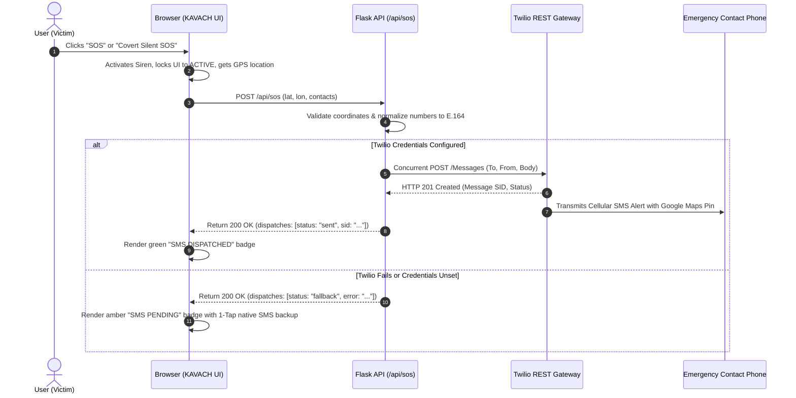

# Design Specification: Automatic Twilio SMS Emergency Alert Dispatch for KAVACH

**Date:** 2026-11-19  
**Status:** In Review (Brainstorming Design Phase)  
**Target Platform:** KAVACH Women's Safety Platform (Flask / Vercel Serverless / Vanilla JS)

---

## 1. Intent & Problem Statement

### 1.1 The Problem
Today, KAVACH dispatches distress alerts via WhatsApp Web/App 1-tap links (`https://api.whatsapp.com/send?...`). When an SOS is triggered:
1. It attempts to automatically open a WhatsApp tab in the browser, which can be blocked by browser popup blockers.
2. It requires manual action by the victim: once WhatsApp opens, they must still manually tap or click "Send". In an acute crisis (being attacked, held, or having seconds to react), requiring multiple manual taps across separate apps introduces dangerous friction.
3. It assumes both the user and their emergency contacts have active internet data connectivity and active WhatsApp installations. Cellular SMS operates even over basic 2G/cellular voice networks without data.

### 1.2 The Intent
Replace the WhatsApp dispatch system with **automatic, autonomous SMS broadcast powered by Twilio**:
- When the user activates SOS (Loud Siren SOS or Covert Silent SOS), KAVACH automatically and immediately transmits individual cellular SMS alerts to every trusted contact in the background.
- Zero manual confirmation, zero popup permissions, and zero secondary taps are required from the victim.
- Emergency contacts receive standard SMS text messages with the distress alert and live Google Maps coordinates immediately.
- The KAVACH dashboard provides real-time delivery status feedback.

---

## 2. Goals, Non-Goals, and Anti-Goals

### 2.1 Goals
- **Autonomous Background SMS Dispatch:** When `POST /api/sos` is triggered, the backend automatically sends cellular SMS to all active trusted contacts via Twilio's REST API without user prompts.
- **Zero-Friction Emergency Execution:** A single press of the SOS button initiates the full emergency sequence without opening external messaging apps or requiring additional clicks.
- **E.164 Phone Number Normalization:** Automatically format contact phone numbers to the E.164 standard required by telecommunications carriers (defaulting to India `+91` if no country code is specified, while cleanly preserving existing international prefixes).
- **Delivery Status Tracking & UI Feedback:** Track Twilio message statuses (`queued`, `sent`, `delivered`, `failed`) and display clear, color-coded badges on the dashboard for each contact.
- **Incident Audit Trail Integration:** Log every SMS dispatch attempt, message SID, destination phone number, and delivery status to the SQLite/audit database table.
- **Resilient Fallback Mode:** If Twilio credentials are unset, Twilio services are unreachable, or a trial account restriction triggers an error (e.g., unverified destination number), the system immediately logs the error, informs the user on screen, and renders a 1-tap native cellular SMS link (`sms:phone?body=...`) as an immediate backup.
- **Mock/Dev Simulation Mode:** If Twilio environment variables are omitted or invalid during local testing or CI runs, simulate dispatch with clear log notices so development and automated tests never crash.
- **UI/UX Modernization:** Convert all references to "WhatsApp" across the UI (cards, pills, tables, headers, and quick-action icons) to "SMS Broadcast" and standard SMS messaging indicators.

### 2.2 Non-Goals
- Two-way conversational SMS or parsing incoming replies from contacts (replies should be direct calls or SMS to the user's phone).
- Sending recurring SMS alerts on every continuous GPS breadcrumb update (the initial SMS contains a live Google Maps pin; repeated SMS every few seconds would deplete Twilio credits and flood recipient inboxes).
- Dedicated hardware GSM/SIM shield in this milestone (dispatches occur via the web application's cloud Twilio integration).

### 2.3 Anti-Goals
- **NEVER block the emergency response on Twilio latency:** The panic alarm, siren, local state transition, and live GPS map must trigger instantly regardless of network speed or Twilio response times.
- **NEVER expose Twilio credentials in client-side code:** All Twilio REST calls and credentials remain strictly server-side in `app.py`.
- **NEVER fail silently:** If Twilio encounters an error, the dashboard must immediately make the failure visible and offer an alternate action (such as direct speed dial or 1-tap native SMS).

---

## 3. Approaches Considered & Selected

### Approach 1 (Selected): Integrated Backend Twilio Dispatch with Fail-Safe Fallback
- **Description:** Implement direct Twilio dispatch in `app.py` using Twilio's official Python SDK or lightweight HTTPS requests. Read credentials (`TWILIO_ACCOUNT_SID`, `TWILIO_AUTH_TOKEN`, `TWILIO_PHONE_NUMBER`) from environment variables. Concurrently dispatch SMS to all trusted contacts on `POST /api/sos`, return individual dispatch statuses in the API response, update UI status pills, and render 1-tap SMS fallback links if Twilio fails.
- **Why Chosen:** Delivers instant, autonomous dispatch without requiring extra infrastructure (like Redis or separate worker daemons). Compatible with local development and Vercel serverless deployment.

### Approach 2 (Rejected): Heavy Background Queue Worker (Celery / Redis / Vercel Queue)
- **Description:** Push SMS dispatch tasks onto a background queue with separate worker processes.
- **Why Rejected:** Unnecessary architectural complexity for small emergency circles (typically 2–5 contacts). Requires provisioning and maintaining paid Redis or queue instances, which are unsupported in free Vercel serverless setups and introduce additional points of potential failure during a life-safety crisis.

### Approach 3 (Rejected): Client-Side Direct Twilio API Calls
- **Description:** Call Twilio's REST API directly from the browser in `static/app.js`.
- **Why Rejected:** Exposes the private Twilio Auth Token in public frontend JavaScript, creating a severe security vulnerability.

---

## 4. System Architecture & Detailed Flow



### 4.1 Phone Number Normalization & Routing Logic
Phone numbers in India and internationally can be entered in various formats (e.g., `9876543210`, `09876543210`, `+919876543210`, `+1 (555) 234-5678`), alongside emergency short codes (e.g., `112`, `100`, `1091`).

The backend implements `normalize_and_route_contact(phone, default_country_code="+91")`:
1. **Short Codes / Helplines ($\le 5$ digits):**
   - Telecommunication gateways (including Twilio) strictly prohibit sending SMS to emergency service numbers like `112` or `100`.
   - Any contact with $\le 5$ digits is automatically classified as `HELPLINE_SPEED_DIAL`.
   - It bypasses Twilio SMS dispatch entirely and is assigned status `"helpline_speed_dial"` with a direct `tel:<number>` link so it never causes a validation failure or Twilio error during an emergency.
2. **Cellular Numbers ($\ge 10$ digits):**
   - Strip whitespace, hyphens, and non-digit characters (preserving leading `+`).
   - If starting with `0` and 11 digits (e.g., `09876543210`), strip leading `0` and prepend `default_country_code`.
   - If exactly 10 digits, prepend `default_country_code`.
   - If already starting with `+` followed by 10–15 digits, validate and preserve.
   - Any cellular number failing this format is rejected with a clear validation message.

### 4.2 Dispatch Lifecycle & Status Model
To ensure maximum reliability without requiring public tunneling or webhook daemons that fail on local development or serverless cold starts:
1. **Synchronous Immediate Dispatch:** Twilio's `POST /Messages.json` API returns synchronously with initial status (`sent` or `queued`). This initial status is returned directly in the `POST /api/sos` response to the frontend.
2. **UI Status Indication:**
   - `sent` / `queued`: Rendered with a solid green pill: `📨 SMS Sent via Twilio`.
   - `simulated`: Rendered with a blue pill: `🧪 SMS Simulated (Dev Mode)`.
   - `helpline_speed_dial`: Rendered with a red call pill: `📞 Call Helpline (112)`.
   - `failed`: Rendered with an amber alert pill: `⚠️ SMS Failed (1-Tap Fallback)` with an immediate `sms:` native cellular link.
3. **No Heavy Webhooks:** Avoids asynchronous `StatusCallback` webhooks and external pub/sub brokers, ensuring zero setup friction and zero deployment failures.

### 4.3 Deduplication & Retrigger Cooldown
To protect user Twilio account credits from accidental double-taps, client-side retry loops, or spamming contacts:
1. **30-Second Dispatch Cooldown:** If an emergency is already `ACTIVE` and `POST /api/sos` is called again within 30 seconds of the last dispatch, the server marks the session active, updates GPS coordinates, but suppresses duplicate Twilio SMS dispatches, returning `"status": "cooldown_suppressed"`.
2. **Initial GPS Fallback Fix:** If the SOS was triggered before the browser acquired a high-accuracy GPS fix (e.g. coordinates were initially null), the first valid coordinates received via `POST /api/location` will automatically trigger the one-time GPS SMS dispatch if not yet sent.

### 4.4 Message Content Template
To ensure high deliverability, avoid carrier filtering, and fit within standard 160-character single-segment SMS limits when possible:
```text
EMERGENCY SOS! I need immediate help. My location: https://maps.google.com/?q={lat},{lon} - Sent via KAVACH
```

### 4.5 Endpoint Specifications

#### `POST /api/sos`
- **Request Body:**
  ```json
  {
    "latitude": 12.9716,
    "longitude": 77.5946,
    "accuracy": 15.0,
    "mode": "STANDARD",
    "contacts": [
      {"name": "Mom", "phone": "9876543210"},
      {"name": "Police", "phone": "112"}
    ]
  }
  ```
- **Response Body:**
  ```json
  {
    "ok": true,
    "status": "ACTIVE",
    "emergency_id": 42,
    "timestamp": "2026-11-19T16:15:00",
    "dispatches": [
      {
        "contact_name": "Mom",
        "contact_phone": "+919876543210",
        "channel": "SMS",
        "status": "sent",
        "sid": "SMxxxxxxxxxxxxxxxxxxxxxxxxxxxxxxxx",
        "error": null,
        "fallback_sms_url": "sms:+919876543210?body=EMERGENCY%20SOS!..."
      }
    ]
  }
  ```

---

## 5. User Interface & Branding Updates

| Area | Current (WhatsApp) | Updated (SMS Broadcast) |
| :--- | :--- | :--- |
| **Section Eyebrow** | `WHATSAPP & EMERGENCY DISPATCH` | `CELLULAR SMS & EMERGENCY DISPATCH` |
| **Section Header** | `Emergency WhatsApp Broadcast` | `Emergency SMS Broadcast Hub` |
| **Status Pill** | `WHATSAPP READY` (`#25D366`) | `SMS BROADCAST READY` (`#38bdf8`) |
| **Dispatch Cards** | `💬 Send WhatsApp` button | `📨 SMS Dispatched` pill / `💬 1-Tap SMS` backup |
| **Contact Actions** | WhatsApp icon (💬) | SMS icon (✉️) linking to `sms:phone` |
| **Auto-open Tab** | Launches `web.whatsapp.com` tab | Removed entirely (silent background server dispatch) |

---

## 6. Configuration & Environment Variables

The following environment variables will be read from the environment or `.env`:

| Variable | Description | Required | Example |
| :--- | :--- | :--- | :--- |
| `TWILIO_ACCOUNT_SID` | Twilio Account SID from console | Yes (for real SMS) | `ACxxxxxxxxxxxxxxxxxxxxxxxxxxxxxxxx` |
| `TWILIO_AUTH_TOKEN` | Twilio Auth Token from console | Yes (for real SMS) | `your_auth_token_here` |
| `TWILIO_PHONE_NUMBER` | Twilio virtual phone number in E.164 | Yes (for real SMS) | `+12055550199` |
| `TWILIO_DEFAULT_COUNTRY` | Default country code for 10-digit numbers | No (defaults to `+91`) | `+91` |

If any of `TWILIO_ACCOUNT_SID`, `TWILIO_AUTH_TOKEN`, or `TWILIO_PHONE_NUMBER` are unset, KAVACH automatically operates in **Simulated SMS Mode**:
- Logs a clear console message: `[Twilio Warning] Credentials not found. Operating in simulation mode.`
- Marks the dispatch status as `"simulated"` in API responses and audit logs.
- Continues running smoothly without crashing or failing tests.

---

## 7. Testing & Verification

1. **Unit Tests (`tests/test_api.py`):**
   - Test phone normalization for 10-digit numbers, 11-digit numbers with leading 0, and numbers with existing `+91`/international codes.
   - Test `POST /api/sos` dispatch simulation when Twilio is not configured.
   - Test `POST /api/sos` dispatch with mocked Twilio API returning success (`sent`).
   - Test `POST /api/sos` graceful degradation when Twilio API raises an exception (returns fallback status without 500 error).
2. **End-to-End Local Testing:**
   - Run Flask server locally and verify SOS triggers without opening new WhatsApp browser tabs.
   - Verify UI cards update with SMS status pills.
3. **Vercel Serverless Parity:**
   - Verify `api/index.py` handles the new Twilio logic without bundling issues.

---

## 8. What is Left to the Builder
- Choosing whether to invoke the official `twilio` Python package or direct `urllib.request`/`requests` (official `twilio` package recommended for robust error parsing).
- Thread pooling concurrency strategy for dispatching to multiple contacts simultaneously (e.g. `concurrent.futures.ThreadPoolExecutor`).
- Exact visual animation for the SMS delivery pill in `static/style.css`.
